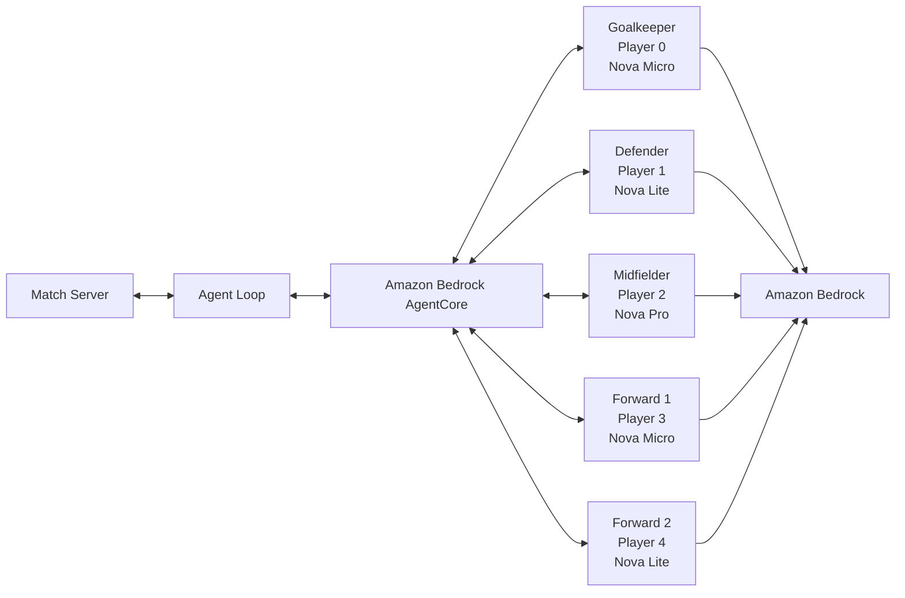
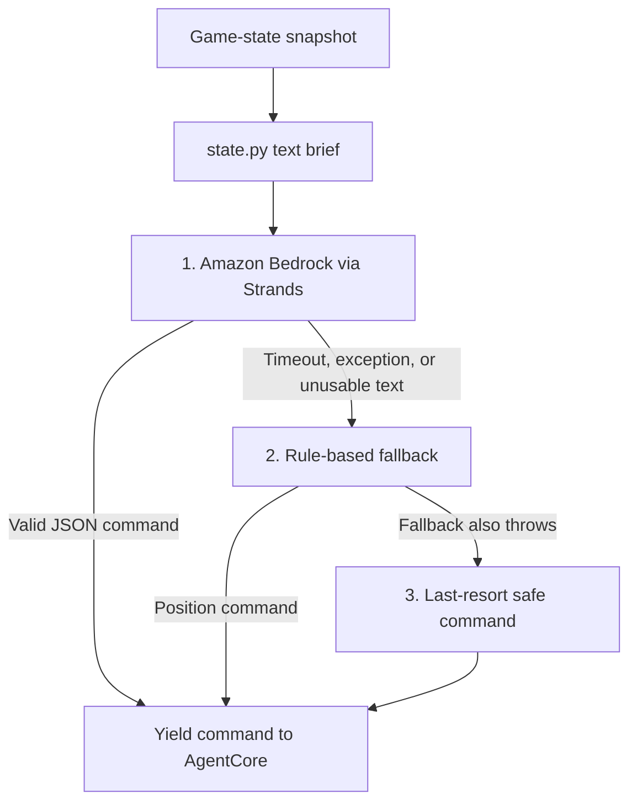

# Building a Five-Agent Football Team on Amazon Bedrock

I recently participated in the [AWS Agentic Football Cup](https://www.linkedin.com/posts/snehasrik21_aws-amazonbedrock-bedrockagentcore-activity-7510462817162969088-H7ku) — a hackathon about building and deploying a multi-agent AI system, not about writing a soccer bot in isolation.

The brief was concrete. Build a team of **five autonomous football agents**. Each one owns a position. Each one reads live game state. Each one has a few seconds to return a valid action during a 5v5 match. There is no central coach calling every play. If the team looks coordinated, it is because the roles, prompts, models, and guardrails made independent decisions add up on the pitch.

I built the team with the [Strands Agents SDK](https://github.com/strands-agents/sdk-python), [Amazon Bedrock](https://aws.amazon.com/bedrock/), and [Amazon Bedrock AgentCore](https://docs.aws.amazon.com/bedrock-agentcore/). The code is public: [github.com/snehasrikanth/Agentic-AI-Football-Cup](https://github.com/snehasrikanth/Agentic-AI-Football-Cup).

The interesting part was not “can an LLM kick a ball.” It was the same set of problems that show up in production agent systems:

- Turning structured context into reliable, low-latency decisions
- Coordinating independently deciding agents into a coherent team
- Defining clear system prompts, decision hierarchies, and guardrails
- Enforcing structured outputs and resilient fallback behavior
- Testing, observing, and iterating on agent performance

Watching those design choices play out on a live 3D pitch made the tradeoffs obvious. A vague prompt looked like two strikers occupying the same channel. A malformed JSON response looked like a player freezing. A model that “reasoned well” but missed the deadline looked like a missed tackle.

This post is the long version of that [LinkedIn recap](https://www.linkedin.com/posts/snehasrik21_aws-amazonbedrock-bedrockagentcore-activity-7510462817162969088-H7ku): how Amazon Bedrock was actually used, how AgentCore hosted the agents, how the shared library kept them alive when the model failed, and how Memory and Gateway changed the design once the baseline team worked.

## What you own, and what the workshop owns

The workshop runs the match server, physics, orchestration, and the Player Portal. You provide five independently deployed agents in your own AWS account, in `us-east-1`.

```text
Workshop infrastructure                 Your AWS account

Player Portal
     |
Match Server <-> Agent Loop <---------> Amazon Bedrock AgentCore
                                          |- Player 0: Goalkeeper
                                          |- Player 1: Defender
                                          |- Player 2: Midfielder
                                          |- Player 3: Forward 1
                                          `- Player 4: Forward 2
```

Approximately every **two seconds**, the Agent Loop sends each agent a game-state snapshot. Each agent has **at most five seconds** to return one valid football command for its player.



Amazon Bedrock is the model layer. AgentCore is the runtime that receives the match payload, runs the Strands agent, and returns JSON. The football server never talks to a model directly. It talks to an AgentCore endpoint that you registered by ARN.

That split matters. You can change a prompt or a model ID and redeploy a single player without touching the match server. You can also swap the entire hosting path — console Harness versus code Runtime — as long as you register the matching ARN type. More on that below.

## The pitch, and the snapshot the model actually sees

The field is approximately `x = -55..+55` and `y = -35..+35`:

- HOME (`teamId = 0`) defends `-x` and attacks `+x`
- AWAY (`teamId = 1`) defends `+x` and attacks `-x`

Every agent must interpret “near my goal” from `teamId`, not from a hardcoded side of the field. A keeper prompt that always sits at `x = -50` is correct at home and a disaster away.

The raw snapshot includes:

- Ball position, velocity, and possession
- Positions and movement of both teams
- Score, clock, and play mode
- Player stamina and current actions
- `teamId`, which sets attacking direction
- `myPlayers`, identifying the player this invocation controls
- `teamChat`, containing live coach instructions

Models are bad at raw nested JSON under a five-second budget, so `lib/state.py` turns that payload into a short text brief before the Bedrock call. A typical summary looks like this:

```text
Time: 84s | Score: 1-0 | Team: 0 (HOME) | PlayMode: 0
Ball: (12.4, -3.1) held by MY player 2
Your goal at x=-55 | Opponent goal at x=55

>>> YOUR PLAYER (MID, id=2): pos=(8.0,-1.2) stam=71 distBall=4.8 distOppGoal=47.0 hasBall=True

Teammates:
  GK(id=0): (-49.2, 1.1)
  P1: (-22.0, 4.4)
  P3: (31.5, -8.0)
  P4: (28.0, 14.2)

Opponents:
  P0: (51.0, 0.4) distToMyGoal=106.0 distToMe=43.1
  ...
```

That brief is the only thing the model sees on a normal tick. It is deliberately small: clock, score, who has the ball, where *this* player is, where teammates are, and how close opponents are to our goal. The system prompt then decides what to do with it.

`state.py` also tolerates two game-server shapes — newer `agentId` / `teamCode` / `possessionAgentId` and older `playerId` / `teamId` / `possessionPlayerId` — so the same agents keep working if the match payload evolves.

## Two ways to put an agent on Amazon Bedrock

The cup allows two build paths. They both end in AgentCore. They do **not** share ARN types.

| | Path A — AgentCore Harness | Path B — Strands + AgentCore Runtime |
| --- | --- | --- |
| Where the “brain” lives | Instructions pasted in the AWS console | Python in `src/main.py` |
| Model | Chosen in the Harness UI | `BedrockModel(model_id=...)` in code |
| Parsing and fallbacks | Prompt-only | Deterministic parser + rule fallback + last resort |
| Local tests | Fitness test in the console | `test_local.py`, with or without `--llm` |
| Logs | Harness test output | CloudWatch via AgentCore observability |
| ARN you register | **Harness ARN** | **Runtime ARN** |
| Best for | Fast prompt iteration | Control, reliability, Memory, Gateway |

Do not mix them. A Harness agent registered with a Runtime ARN (or the reverse) will not play.

I used **Path B** for the team in this repo, because I wanted the three-layer safety net, CloudWatch, and a path to Memory and Gateway. Path A is still worth understanding, because it is the fastest way to see whether a prompt is even coherent before you spend time on code.

### Path A: Harness, no code

1. Sign in to the AWS console in `us-east-1`.
2. Open **Amazon Bedrock → AgentCore → Harness**.
3. Use **Advanced create harness** (not the quick-create default).
4. Name it for one player only, for example `ai_gk_agent`.
5. Pick a Bedrock model that is enabled in the workshop account.
6. Paste **only that player’s** system prompt into Instructions. Never paste all five prompts into one harness.
7. Permissions: **Use another role**, and select the pre-provisioned role that starts with `team-SolutionAccessRole-`. Do not create a default role. Workshop accounts generally cannot create IAM roles.
8. Create the harness and wait until status is **Ready**.
9. Copy the **Harness ARN**. Ignore the Runtime ARN shown elsewhere in the console.

Repeat for `ai_def_agent`, `ai_mid_agent`, `ai_fwd1_agent`, and `ai_fwd2_agent`.

Model choice on Harness is a latency-versus-reliability decision:

- A model that misses the five-second deadline cannot help, no matter how good the reasoning is.
- A very small model answers quickly and then emits broken JSON or misunderstands possession.
- Larger models follow a strict output format more reliably, until they don’t fit in the budget.

A practical starting point, when the account allows it, is something responsive and capable such as Claude Sonnet or Amazon Nova Pro. For the goalkeeper, output reliability beats elaborate reasoning. For the midfielder, tactical reasoning is worth more because passing and positioning are wider decision trees. If fitness tests time out, switch to a faster model. If they return prose instead of JSON, shrink the allowed command list and add a concrete JSON example.

Editing a Harness agent is just saving new Instructions or a new model. No redeploy.

### Path B: Strands calling Amazon Bedrock inside AgentCore Runtime

This is the path the repository implements. Each player is a small Python app:

```text
ai-gk/
├── src/main.py                          # Prompt, model ID, fallback, invoke handler
├── .bedrock_agentcore.yaml.template     # AgentCore config template
├── pyproject.toml
├── requirements.txt
└── test_local.py                        # Offline tests; --llm hits Bedrock
```

Dependencies are intentionally small:

```text
strands-agents
bedrock-agentcore
bedrock-agentcore-starter-toolkit
aws-opentelemetry-distro
```

Strands is the agent framework. Amazon Bedrock is the model provider. AgentCore is the HTTP runtime the match server calls. OpenTelemetry is there so model calls, latency, and errors show up after deploy.

The model call itself is four lines in `lib/agent_base.py`:

```python
from strands import Agent
from strands.models import BedrockModel

def create_agent(system_prompt: str, model_id: str = "us.amazon.nova-micro-v1:0") -> Agent:
    model = BedrockModel(model_id=model_id)
    return Agent(model=model, system_prompt=system_prompt)
```

`BedrockModel` uses the AWS credentials of the AgentCore execution role (or your local CLI credentials when you run `--llm` tests). There is no separate model client to maintain. Changing models is changing the `model_id` string and confirming that model is enabled in `us-east-1`.

The runtime entrypoint is `BedrockAgentCoreApp` from `bedrock_agentcore.runtime`. `create_invoke_handler` registers `@app.entrypoint`. On each tick AgentCore posts a payload; the handler reads `prompt`, `gameState`, `teamId`, and `myPlayers`, summarizes state, calls the Strands agent, parses the reply, and **yields a JSON string** of commands.

```python
app = BedrockAgentCoreApp()

MY_PLAYER_ID = 0
POSITION_LABEL = "GK"

agent = create_agent(SYSTEM_PROMPT, model_id="us.amazon.nova-micro-v1:0")
create_invoke_handler(
    app, agent, MY_PLAYER_ID, POSITION_LABEL, fallback_commands,
    fallback_cfg=GK_CONFIG,
)
```

Every position file follows that shape. The football lives in `SYSTEM_PROMPT` and the fallback config. The Bedrock wiring does not.

## Which Bedrock model plays which position

The balanced team does not give every player the biggest model. Under a five-second budget, model choice is a tactical decision.

| Player | Role | Bedrock model ID | Why |
| --- | --- | --- | --- |
| 0 | Goalkeeper | `us.amazon.nova-micro-v1:0` | Narrow action set. Stay on the line, distribute, don’t overthink. |
| 1 | Defender | `us.amazon.nova-lite-v1:0` | Positioning, pressing, and safe distribution. |
| 2 | Midfielder | `us.amazon.nova-pro-v1:0` | Widest tree: pass, shoot, press, mark, or occupy space. |
| 3 | Forward 1 | `us.amazon.nova-micro-v1:0` | Shoot-first striker. Speed matters more than nuance. |
| 4 | Forward 2 | `us.amazon.nova-lite-v1:0` | Supporting striker: width, through balls, when *not* to shoot. |

Amazon Nova is the default family in this repo because it is available as a Bedrock foundation model with a cross-region inference profile (`us.` prefix), which is what the workshop accounts expect. The same `create_agent(..., model_id=...)` slot can point at another Bedrock model ID if that model is enabled in the account — Claude, for example, on the Harness path — but the code team is built and tested on Nova Micro, Lite, and Pro.

Rules I used while picking models:

1. **If it misses five seconds, it is the wrong model**, even if the reasoning is beautiful.
2. **Put the stronger model where the action space is widest.** That is the midfielder.
3. **Put the fastest model where the correct action is usually obvious.** That is the goalkeeper and the primary striker.
4. **One change at a time.** Swap a model *or* a prompt, then replay. Changing both makes the match impossible to interpret.
5. **Confirm model access before you debug tactics.** `AccessDeniedException` in CloudWatch is not a bad prompt. It is Bedrock model access or the execution role.

Nova Micro on the striker is a deliberate trade. Player 3’s prompt is a short priority list (“inside 18, shoot unless the lane is dead”). A small model can follow that. Player 2’s prompt has conditionals about pressing only when closer than both forwards, through balls, late-game behavior, and when to drop next to the defender. That is why the playmaker is Nova Pro.

## Five jobs, one shared library

The balanced team is a **1-1-1-2**:

- Player 0 — goalkeeper, on the line
- Player 1 — deepest defender
- Player 2 — central playmaker
- Player 3 — primary striker, left/central channel
- Player 4 — supporting striker, right channel

The formation is not sacred. Each agent’s role is the system prompt. You can run two midfielders or three forwards without changing the match server. You change who may occupy which zone and who may shoot.

All of that sits on one library so five runtimes do not drift apart:

```text
agentic-football-sample-agents/
├── BUILD_AND_DEPLOY.md
├── lib/
│   ├── agent_base.py       # Bedrock model + Strands agent + 3-layer invoke
│   ├── fallback.py         # Rule-based commands per position
│   ├── parsing.py          # Extract JSON commands from the model text
│   ├── json_tolerant.py    # Recover Python-flavored JSON after a strict parse fails
│   ├── state.py            # Game-state summary sent to Bedrock
│   ├── _bootstrap.py       # Find lib/ locally and inside the deployed zip
│   ├── test_helpers.py     # Mock AgentCore + sample state
│   └── test_parsing.py
├── ai-team-strands-balanced/
├── ai-team-strands-extremely-aggressive/
├── ai-team-strands-extremely-defensive/
├── ai-team-strands-memory/
└── ai-team-strands-gateway/
```

Each team folder then looks like this:

```text
ai-team-strands-balanced/
├── ai-gk/  ai-def/  ai-mid/  ai-fwd1/  ai-fwd2/
├── agentcore/agentcore.json     # Five CodeZip runtimes, HTTP, public network
├── agentcore/cdk/               # CDK app used by `agentcore deploy`
├── deploy_all.py
├── deploy-all.sh
├── deploy-all-windows.ps1
└── README.md
```

`agentcore.json` declares five runtimes — `ai_gk_agent` through `ai_fwd2_agent` — each with `build: CodeZip`, `entrypoint: src/main.py`, `runtimeVersion: PYTHON_3_12`, `protocol: HTTP`. Deploy copies `lib/` into each agent so the zip is self-contained, then deletes the copy. The shared library stays the single source of truth and is never committed inside an agent folder.

## How the five agents coordinate without talking

None of these agents call each other. They coordinate **implicitly**, through role boundaries written into the prompts. That was the design I wanted to test: can five Bedrock calls, each ignorant of the others’ chain of thought, still look like a team?

The rules that actually matter:

- Only the closest suitable player presses.
- If one forward presses, the other stays high for the counter.
- The defender stays behind the midfielder.
- The two forwards use different channels so they do not occupy the same grass.
- Pass and shoot only when possession is explicit.
- Maintained commands (`PRESS_BALL`, `MARK`, `INTERCEPT`, `FOLLOW_PLAYER`) use short durations, usually one or two ticks, so the agent can reconsider instead of locking into a bad run.

A bad prompt in this environment:

> Be creative and play like a world-class striker.

A prompt the physics engine can execute:

> If player 3 has possession within 18 units of goal, SHOOT unless the route is completely blocked.

For each player I wrote seven things before touching model IDs:

1. **Identity** — exact player ID and role.
2. **Zone** — where they normally stand.
3. **Decision hierarchy** — in possession, out of possession, and when the ball is loose.
4. **Coordination** — when to defer so two agents do not do the same job.
5. **Constraints** — actions and areas they must not use.
6. **Output contract** — exactly one JSON command for the correct player.
7. **Safe default** — usually `MOVE_TO` when the right action is uncertain.

### Goalkeeper — Nova Micro

Protect the goal, collect loose balls that are clearly yours, distribute quickly. HOME sits near `x = -50`. AWAY sits near `x = +50`. Track the ball laterally but keep `target_y` between `-7` and `+7`. Never step into midfield.

Priority:

1. In possession: `THROW` to player 1 if open, else player 2, else `KICK` to the forward with more space.
2. Immediate close-range chance and no defender can help: `INTERCEPT` with `aggressive=true` for 2 ticks.
3. Loose ball near goal that you reach first: `INTERCEPT`, aggressive only if a shot is coming.
4. Otherwise `MOVE_TO` on the line, `sprint=false` unless you are recovering.

Allowed commands: `MOVE_TO`, `GK_DISTRIBUTE`, `INTERCEPT`.

### Defender — Nova Lite

Deepest outfield player. Stay between the ball and your goal, behind player 2. HOME holds roughly `x = -38..-15`. AWAY holds `x = +15..+38`. Never chase into the opponent’s defensive third.

Priority:

1. In possession: ground pass to the midfielder, through ball if a forward is clearly free, back to the keeper if pressed.
2. Immediate central route to goal: `PRESS_BALL` only if you can challenge now. `SLIDE_TACKLE` only to stop an imminent shot nobody else can reach.
3. Loose ball in your half that you reach first: `INTERCEPT`.
4. `MARK` only an immediate central scoring threat, tight, for 2 ticks. Do not mark while your team has the ball.
5. Otherwise `MOVE_TO`, central and goal-side.

### Midfielder — Nova Pro

Supply the forwards, support the defender, own the center. Forward passing is the first attacking job. Do not spend the match marking.

Priority:

1. In possession: `THROUGH` to player 3 or 4 if either is in behind; otherwise a ground pass to the more open forward. Shoot inside 22 if the lane is clear or partly clear, aimed low and away from the keeper (`BL` or `BR`, power about `0.82–0.90`). If every forward is closed, play back to the defender. Never pass or shoot without possession.
2. Teammate has the ball: move into open central space behind the forwards. Do not stand on a teammate.
3. Opponent has the ball: press only if you are closer than both forwards and can challenge immediately (`intensity` about `0.75–0.85`, duration 2). If a forward is already pressing, move to cut the central lane. Track back if the defender is outnumbered.
4. Loose midfield ball you reach first: `INTERCEPT`.
5. Mark only an unmarked central receiver in your own half, and not while you are in possession.

The prompt also has opponent-style and game-state branches: drop closer to the defender against an aggressive side; play higher against a deep block; safer passes when leading late; more progressive passes when trailing late. This is why this seat gets Nova Pro.

### Forward 1 — Nova Micro, left/central

Primary scorer. Channel roughly `y = -18..+4`. Stay away from player 4.

Priority:

1. In possession, inside 18 of goal: shoot unless the route is completely blocked. Between 18 and 30: shoot if the lane is usable and no teammate has an obviously better chance. Aim `BL`/`BR`, power about `0.84–0.94`. If the shot is dead, ground pass to player 4, through ball if player 4 is in behind, otherwise back to the midfielder.
2. When the defender or midfielder has the ball: attack the space between defenders, sprint when a lane exists, and arrive around `x = +38..+47` (or the away mirror) in the final third.
3. When player 4 has the ball: attack the center or the far post. Do not stand next to them.
4. Press only if you are the closest forward, the ball is in the opponent half, and you can challenge now.
5. If player 4 is pressing, stay high for the counter.

### Forward 2 — Nova Lite, right channel

Supporting striker. Channel roughly `y = +5..+20`. Same shooting instinct inside 18, a slightly tighter window (18–27) for speculative shots, and an explicit duty to give the better chance to player 3.

The two forwards are not clones. Player 3 is “shoot unless it is impossible.” Player 4 is “stretch the defense, and pass when player 3 is the better finish.” That single difference is most of their coordination.

## The command contract Bedrock must satisfy

The match server does not read chain-of-thought. It reads a JSON array. The recommended design is exactly one command:

```json
[{
  "commandType": "MOVE_TO",
  "playerId": 2,
  "parameters": { "target_x": 8.0, "target_y": -3.0, "sprint": false },
  "duration": 0
}]
```

| Command | Kind | Parameters | Duration |
| --- | --- | --- | --- |
| `MOVE_TO` | One-shot | `target_x`, `target_y`, `sprint` | 0 |
| `PASS` | One-shot | `target_player_id`, `type` (`GROUND` / `AERIAL` / `THROUGH`) | 0 |
| `SHOOT` | One-shot | `aim_location` (`TL`/`TR`/`BL`/`BR`/`CENTER`), `power` 0–1 | 0 |
| `GK_DISTRIBUTE` | One-shot | `target_player_id`, `method` (`THROW` / `KICK`) | 0 |
| `PRESS_BALL` | Maintained | `intensity` 0–1 | 1–2 ticks |
| `MARK` | Maintained | `target_player_id`, `tightness` (`LOOSE` / `TIGHT`) | 1–2 |
| `INTERCEPT` | Maintained | `aggressive` | 1–2 |
| `FOLLOW_PLAYER` | Maintained | `target_player_id`, `target_team`, `distance` | short |
| `SLIDE_TACKLE` | One-shot / rare | `target_player_id`, `sprint`, `distance` | short |
| `SET_STANCE` | Tactical | `stance` (0 balanced, 1 attack, 2 defend) | 0 |
| `CLEAR_OVERRIDE` | Tactical | return to default AI | 0 |

Each system prompt lists **only** the commands that role may use. The goalkeeper cannot `SHOOT`. The striker is not asked to `GK_DISTRIBUTE`. Shrinking the action space is one of the cheapest reliability gains in the project, and it matters more on Nova Micro than on Nova Pro.

`lib/parsing.py` pulls a JSON array out of the model text, checks the command, and forces `playerId` to the player this runtime controls. A model that tries to move a teammate does not get to.

## Three layers, so a player never freezes

A match does not pause because Bedrock returned `True` instead of `true`, or because the call timed out.



**Layer 1 — the model.** Summarize state, call `agent(state_summary)`, parse the string. If commands come back, yield them. This is the only layer that spends Bedrock latency.

**Layer 2 — position rules.** `lib/fallback.py` builds a function from a `FallbackConfig`. The keeper distributes. The defender passes or holds a deep line. Forwards shoot inside a distance threshold or advance. If the model output cannot be parsed, this layer still returns a legal command. It does not call Bedrock.

**Layer 3 — last resort.** If the payload itself is garbage or the fallback throws, emit one safe command from the config, usually `SET_STANCE`. The player keeps moving. For the keeper that stance is defensive (`stance: 2`).

CloudWatch is how you tell the layers apart:

- `LLM returned N commands` — Bedrock is driving.
- `LLM parse failed, using fallback` — the model answered, and the answer was unusable.
- `recovered malformed JSON` — tolerant parsing saved the tick. The model is still driving, but it is being sloppy.
- `agent error` — something threw, and you are on the fallback or the last resort.
- `Timeout` — the model or a tool chain blew the decision budget.
- `AccessDeniedException` — model access, Memory, Gateway, or the execution role. Not a tactics bug.

A functioning fallback can hide a broken prompt. If the player “moves but ignores the tactics,” check fallback frequency before you rewrite the system prompt. The agent looks alive because layer 2 is doing its job.

### The Python-JSON trap

Models are trained on a lot of Python, so they sometimes spell JSON like Python:

```json
[{"commandType": "MOVE_TO", "parameters": {"target_x": 2.0, "sprint": True}}]
```

`True` is valid Python and invalid JSON. A strict parser drops the whole command. The agent falls through to layer 2. There is no crash. The only clue is `LLM parse failed` in the log, and it looks like “the model has no ideas” when the model’s idea was thrown away.

`lib/json_tolerant.py` runs **only after** a strict parse fails. It rewrites a copy of the text:

- bare `True` / `False` / `None` → `true` / `false` / `null`
- a trailing comma before `}` or `]`
- a markdown fence wrapped around the payload

Valid JSON never hits that code. Text inside strings is left alone, so `{"note": "True story"}` stays intact. Recovery is a safety net. If the warning shows up constantly, tighten the prompt. Don’t treat the repair as the design.

## Same runtime, five different teams

Once the library existed, changing personality was a prompt-and-config change, not a new architecture. The repo includes the styles I used as both our own experiments and as the opponents you should practice against.

**Balanced** (`ai-team-strands-balanced`) — the 1-1-1-2 above. Default team. Start here.

**Extremely aggressive** — everyone attacks.

- Keeper plays as a sweeper and can shoot if the ball is near the opponent goal.
- Defender joins the attack and rarely tracks back.
- Midfielder is a second striker: shoot first, pass only forward, don’t defend.
- Both forwards camp near goal.

**Extremely defensive** — park the bus.

- Keeper never leaves the line.
- Defender never crosses halfway and marks tight.
- Midfielder is an extra defender and plays backward.
- Forwards track back and rarely shoot.

**Memory** (`ai-team-strands-memory`) — same roles, plus [Amazon Bedrock AgentCore Memory](https://docs.aws.amazon.com/bedrock-agentcore/latest/devguide/memory.html).

Short-term memory is wired with `AgentCoreMemorySessionManager` from `bedrock_agentcore.memory`, still on a `BedrockModel`:

```python
session_manager = AgentCoreMemorySessionManager(
    agentcore_memory_config=AgentCoreMemoryConfig(
        memory_id=memory_id,
        session_id=f"match-{team_id}-{position_label}",
        actor_id=f"{team_id}-{position_label}",
    ),
    region_name=os.environ.get("AWS_DEFAULT_REGION"),
)
model = BedrockModel(model_id=model_id)
return Agent(model=model, system_prompt=system_prompt, session_manager=session_manager)
```

Each position gets its own session (`match-<team>-GK`, and so on) so the keeper’s history does not pollute the striker’s. The CDK stack creates a `team_memory` resource in the same `agentcore deploy`, grants every runtime access, and injects the memory ID. Prompts tell the model to use recalled history: opponent tendencies, earlier choices, how the half is unfolding. Memory adds latency. I treated it as a second step, after the balanced team already returned valid commands on time.

**Gateway** (`ai-team-strands-gateway`) — same roles, plus [AgentCore Gateway](https://docs.aws.amazon.com/bedrock-agentcore/latest/devguide/gateway.html) exposing tactical tools over MCP. The agent decides whether to call them. Nothing is forced.

- `calculate_pass_options` — pass success from interception risk
- `find_open_space` — open space by zone
- `evaluate_shot` — shot probability and an aim recommendation
- `get_defensive_assignment` — which opponent is the marking priority

The gateway and four Lambda tools are declared next to the five runtimes and created by the same deploy. The endpoint lands in `AGENTCORE_GATEWAY_TACTICAL_TOOLS_URL`. A Strands `MCPClient` is opened around the invoke. This is the “tools” version of the same Bedrock agent: the model can compute instead of guessing, at the cost of another hop inside the five-second budget. Baseline first. Then one tool. Then measure whether goals actually change.

## Test before you spend a deploy

From `agentic-football-sample-agents/ai-team-strands-balanced`:

```bash
python3 ai-gk/test_local.py
python3 ai-def/test_local.py
python3 ai-mid/test_local.py
python3 ai-fwd1/test_local.py
python3 ai-fwd2/test_local.py
python3 ../lib/test_parsing.py
```

Those tests do not call AWS. They check state summaries, parsing, player IDs, and fallbacks against a mock AgentCore app.

When you want a real Bedrock response:

```bash
export AWS_ACCESS_KEY_ID="..."
export AWS_SECRET_ACCESS_KEY="..."
export AWS_SESSION_TOKEN="..."
export AWS_DEFAULT_REGION="us-east-1"
aws sts get-caller-identity

python3 ai-gk/test_local.py --llm
```

Workshop credentials are temporary. If `get-caller-identity` fails, refresh them from Workshop Studio and export all four variables again. Don’t debug a prompt until identity works, and don’t debug a deploy until `--llm` works.

Run the live model test more than once. Confirm:

- The response arrives inside five seconds.
- It is valid JSON.
- It contains exactly one command.
- `playerId` matches the agent.
- The command is legal for that role.
- Pass and shoot do not appear unless that player has the ball.

## Deploy onto AgentCore

Prerequisites: Python 3.10 or newer locally, Node.js 20+, AWS CLI, `uv`, and the AgentCore CLI plus CDK (`npm install -g @aws/agentcore aws-cdk`). One-time per account and region: `cdk bootstrap aws://<account-id>/us-east-1`.

```bash
cd agentic-football-sample-agents/ai-team-strands-balanced
AWS_DEFAULT_REGION=us-east-1 python deploy_all.py
```

Or the shell wrapper, including a single agent:

```bash
AWS_DEFAULT_REGION=us-east-1 ./deploy-all.sh
AWS_DEFAULT_REGION=us-east-1 ./deploy-all.sh ai-gk
```

Windows:

```powershell
$env:AWS_DEFAULT_REGION = "us-east-1"
.\deploy-all-windows.ps1
```

What the deploy actually does:

1. Checks AgentCore CLI, AWS CLI, credentials, and local tools.
2. Runs `cdk bootstrap` (safe to repeat).
3. Stages each agent and copies in `lib/`.
4. Writes `.bedrock_agentcore.yaml` for this account and region.
5. Runs `agentcore deploy`, which ships a CodeZip runtime through CDK.
6. Enables AgentCore observability.
7. Deletes the staged `lib/` copy on success, failure, or Ctrl+C.

Then open **Amazon Bedrock → AgentCore → Runtime**, wait until all five show **Ready**, and copy each **Runtime ARN**.

Register them in the Player Portal at [https://agentic-football.aws.dev](https://agentic-football.aws.dev):

1. Sign in with the event team code.
2. Open **My Team**. Set logo, formation, names, and coach.
3. Map ARNs to positions: player 0 keeper, 1 defender, 2 midfielder, 3 forward, 4 forward.
4. Run **Test your agents**.
5. Play at least one practice match before the tournament matches count.

Harness ARN for Harness. Runtime ARN for this codebase. If the wrong player moves, the bug is almost always a mismatched set: `MY_PLAYER_ID`, the ID inside the prompt, the portal slot, and the ARN.

## Practice, logs, and one-variable changes

Benchmark against all three reference styles:

- Balanced — shape and decision quality
- Extremely aggressive — can you stay deep and counter
- Extremely defensive — can you create a shot without forcing one

Don’t judge a strategy from one match. Bedrock sampling is non-deterministic. Play several matches against the same opponent and compare goals, valid-command rate, latency, fallback frequency, shot quality, possession losses, duplicate pressing, and stamina.

The loop that worked:

```text
Observe -> one hypothesis -> change one variable -> deploy -> replay -> measure
```

One variable means one prompt **or** one model ID **or** one fallback threshold. Not all three.

Live coaching arrives on `gameState.teamChat`. The state summary has to include it if you want the model to obey the sideline. Useful coach text names a player and an action:

```text
Player 3: stay high and attack behind their advanced defender.
```

Useless coach text contradicts the base prompt:

```text
Play better and be aggressive but also stay defensive.
```

Coaching is an override on top of a solid prompt, not a replacement for one.

### Failures I actually hit

| Symptom | What it usually was |
| --- | --- |
| `aws sts get-caller-identity` fails | Expired workshop credentials. Re-export all four variables. |
| `agentcore` not found | Virtualenv not active, or `pip install bedrock-agentcore-starter-toolkit`. |
| `uv` not found | Installer didn’t land on `PATH`. |
| `AccessDeniedException` | Model not enabled in `us-east-1`, or the execution role can’t invoke Bedrock, Memory, or Gateway. |
| Fitness test flakes | Run it again. If it keeps failing, shorter prompt, fewer commands, a JSON example, or a faster model. |
| Player moves, tactics ignored | Fallback is carrying the agent. Read `LLM parse failed`. |
| Wrong player acts | ID, prompt, portal slot, and ARN disagree. |
| Agent “idle” with no error | Python `True`/`False`/`None` discarded by a strict JSON parse. Look for the recovery warning. |

## What I would reuse outside a hackathon

A 5v5 on a 3D pitch is a toy. The failure modes are not.

**Model capability is only one part of the solution.** Clear roles, strong constraints, reliable outputs, low latency, and fast iteration decide whether agents behave consistently. I wrote that after the cup, and the codebase is organized around it: Nova Pro only where the decision is wide, Nova Micro where the decision is narrow, and a non-LLM fallback when Bedrock doesn’t make the deadline.

**Role beats a shared super-agent.** Five small Bedrock calls with non-overlapping jobs beat one model asked to play every position. The agents never message each other. The prompts make collisions expensive to choose.

**Structured output is a product requirement.** If the contract is one JSON command, the prompt, the parser, the tolerant repair, and the fallback all exist to protect that contract.

**Fallbacks are part of the agent.** Timeout is a normal outcome inside five seconds. A rule that still emits `MOVE_TO` is the difference between a player and a statue.

**See the cost.** Local tests catch parse bugs. The live match catches two strikers standing on the same blade of grass. CloudWatch tells you which layer actually played the tick. You need all three.

**Add platform features after the baseline is boring.** Memory and Gateway are in the repo because they are the production knobs — recall and tools — but both spend the same five-second budget the model needs. Reliable commands first, coordination second, sophistication third.

## Run it

Repository: [github.com/snehasrikanth/Agentic-AI-Football-Cup](https://github.com/snehasrikanth/Agentic-AI-Football-Cup)

```bash
git clone https://github.com/snehasrikanth/Agentic-AI-Football-Cup
cd Agentic-AI-Football-Cup/agentic-football-sample-agents/ai-team-strands-balanced
python3 ai-gk/test_local.py
AWS_DEFAULT_REGION=us-east-1 python deploy_all.py
```

The longer workshop path — Harness and Runtime, command schema, portal registration, and the troubleshooting list — is in [`BUILD_AND_DEPLOY.md`](https://github.com/snehasrikanth/Agentic-AI-Football-Cup/blob/main/agentic-football-sample-agents/BUILD_AND_DEPLOY.md).

Football made the system honest. When an agent froze, you saw it. When two roles collided, you saw it. When Bedrock was slow, the ball was already gone. That visibility is what I want more production agent systems to have: not a prettier demo, a tighter loop between model, constraint, and outcome.

---

### Publish notes for Hashnode

- Cover: a 3D pitch screenshot from the [LinkedIn post](https://www.linkedin.com/posts/snehasrik21_aws-amazonbedrock-bedrockagentcore-activity-7510462817162969088-H7ku).
- Tags: `AWS`, `Amazon Bedrock`, `Bedrock AgentCore`, `Agentic AI`, `Multi-Agent Systems`, `Strands Agents`, `Prompt Engineering`.
- Hashnode renders the Mermaid diagrams in this file.
- Canonical URL: leave blank until the post is live, then set it to the Hashnode URL.
- Optional embed: the original LinkedIn update, so the screenshots stay with the write-up.
